# Práctica 2: Configuración, Usuarios y Administración — UD2 Gestores de Contenido

**Alumno:** Pablo Núñez Fernández
**Curso:** 2º DAW (CFGS Desarrollo de Aplicaciones Web)
**Fecha:** 28 de octubre de 2026
**Sitio:** pablonunez.dev.mialias.net (CDMON, instalación de UD1)
**Temática elegida:** blog personal técnico sobre desarrollo web e IA (misma que en UD1: entradas reales tipo "REA: un MCP para hacer ingeniería inversa con agentes de IA", tema Astra + Elementor).

Documento en construcción, se va ampliando tarea a tarea. Capturas en `capturas/`.

## Tarea 1. Configuración general del sitio

1. **Título y descripción**: cambiados a "Pablo Núñez — Blog de desarrollo e IA" / "Blog personal sobre desarrollo web, IA y herramientas para programadores." (coherente con la temática y dentro de 150 caracteres).
2. **Zona horaria**: ya estaba en Madrid.
3. **Idioma**: ya estaba en Español.
4. **Registro libre de usuarios**: la casilla "Cualquiera puede registrarse" ya estaba desmarcada. Se deja así: en un sitio con roles definidos a mano (Tarea 4), permitir alta libre rompería el control de quién tiene cada permiso — cualquier visitante podría crearse una cuenta sin pasar por el criterio del administrador.
5. **Dirección de WordPress (URL) vs Dirección del sitio (URL)**: la primera es dónde viven los archivos núcleo de WordPress; la segunda es la URL que ve el visitante para acceder al sitio. Suelen coincidir, pero son distintas cuando WordPress está instalado en una subcarpeta (p. ej. `/wordpress/`) y se quiere que la web se vea en la raíz del dominio, o en instalaciones multisitio.

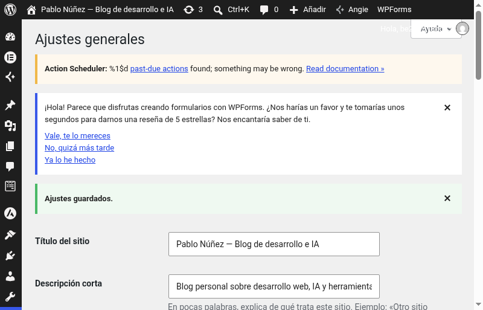

## Tarea 2. Configuración de escritura y lectura

**Ajustes → Escritura**
- Creé la categoría "Artículos" (no existía ninguna aparte de "Sin categoría") y la dejé como categoría por defecto para las entradas, coherente con un blog de desarrollo/IA.
- `rpc.pingomatic.com` es un servicio de notificación: cuando publicas una entrada nueva, WordPress le hace un "ping" automático para avisar a buscadores/agregadores de blogs de que hay contenido nuevo, para que lo indexen antes. Se deja por defecto.

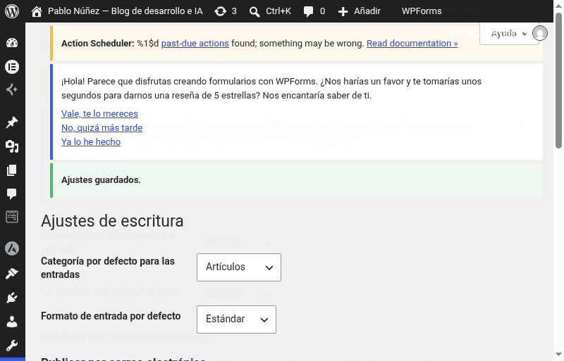

**Páginas creadas** (contenido genérico, se ampliará en unidades posteriores): Inicio, Blog (vacía), Quiénes somos, Contacto.

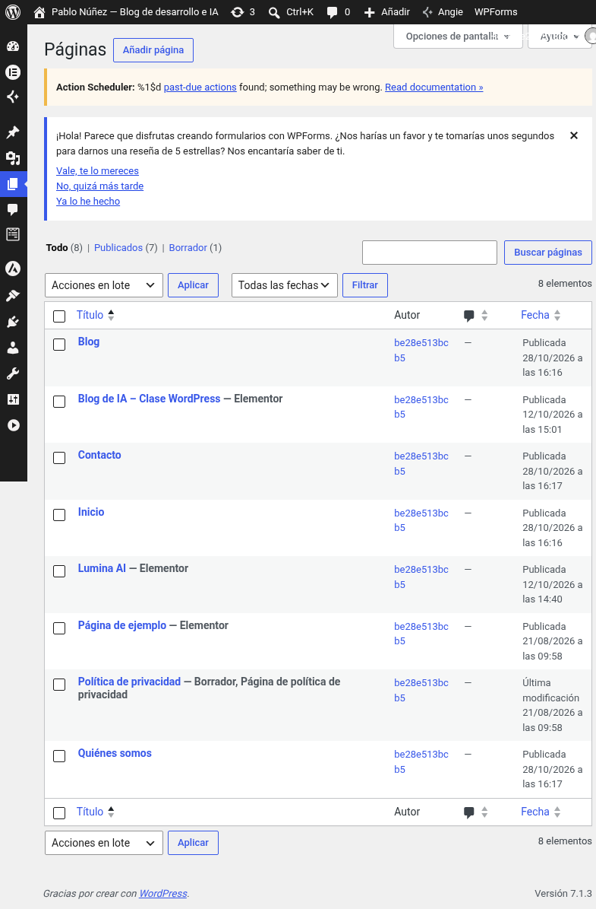

**Ajustes → Lectura**
- Página de inicio: estática → "Inicio" como portada, "Blog" como página de entradas.
- Límite de entradas en archivo: 5. Límite en RSS: 10, mostrando solo el extracto (no el texto completo).
- "Pedir a los motores de búsqueda que no indexen este sitio" se dejó **desmarcada**: es importante en un entorno real porque, si estuviera marcada, Google y el resto de buscadores no indexarían el sitio y nadie lo encontraría por búsqueda orgánica — solo tiene sentido activarla en sitios de pruebas/desarrollo, nunca en producción.

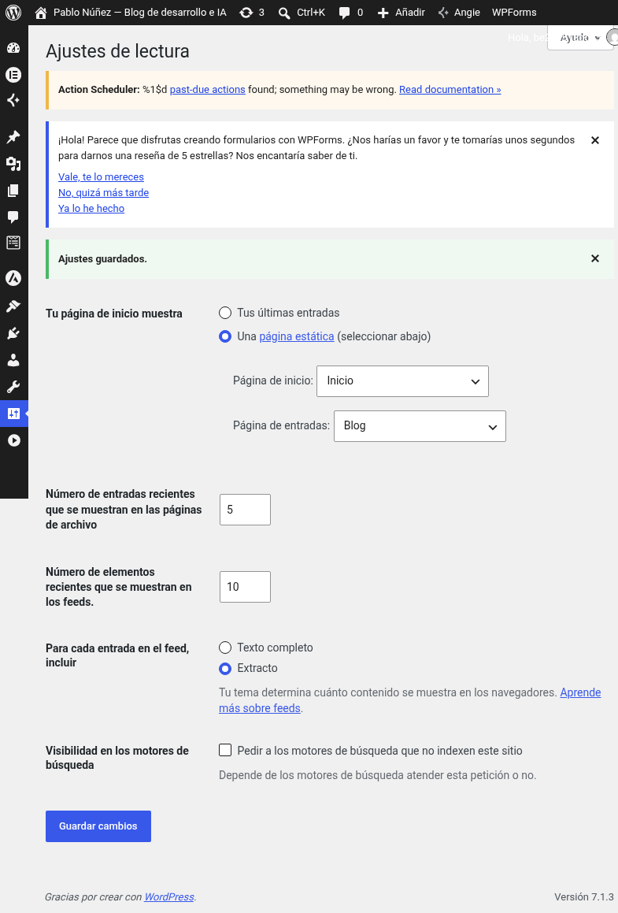

## Tarea 3. Personalización del escritorio

- **Widget oculto**: desde "Opciones de pantalla" (Escritorio), oculté el widget "Eventos y noticias de WordPress" (menos útil para el día a día que "De un vistazo" o "Actividad").
- **Esquema de color**: cambiado de "Por defecto" a "Océano" (Usuarios → Tu perfil). Se nota en el color de la barra superior y el menú lateral, que pasan de gris oscuro a un azul verdoso.
- **2 columnas**: en esta versión de WordPress ya no existe un selector explícito de "número de columnas" (ni en Opciones de pantalla del Escritorio ni en Tu perfil); el propio escritorio organiza los widgets en 2 columnas por defecto según el ancho de pantalla, como se ve en la captura.
- **Atajos de teclado** (del propio material de la unidad, coinciden con el enunciado): `Shift+Alt+C` abre directamente el formulario para añadir un comentario nuevo, `Shift+Alt+M` abre la subida de un medio nuevo, y `Shift+Alt+P` abre el formulario para añadir una página nueva. Son atajos pensados para crear contenido rápido sin navegar por el menú.

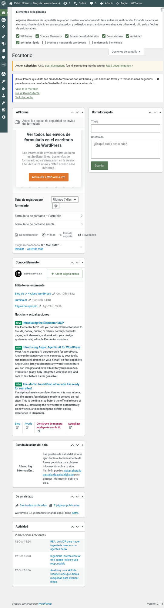

## Tarea 4. Gestión de usuarios y roles

Creé un equipo ficticio de 5 usuarios con el patrón `rol.nombre`, contraseñas de 12+ caracteres (mayúsculas, minúsculas, números y símbolos), nombre público configurado en todos (no el login) y biografía rellenada al menos en Editor y Autor:

| Rol | Usuario | Nombre mostrado | Justificación del rol |
|---|---|---|---|
| Administrador | admin.pablo | Pablo Núñez | Responsable técnico del sitio (junto a la cuenta de acceso original del hosting). |
| Editor | editor.maria | María López | Responsable de contenidos: revisa y publica lo que suben los demás. |
| Autor | autor.carlos | Carlos Ruiz | Redactor de sección: publica sus propias entradas. |
| Colaborador | colaborador.laura | Laura Gómez | Colaboradora esporádica: escribe pero necesita aprobación para publicar. |
| Suscriptor | suscriptor.ana | Ana Torres | Lectora registrada, solo puede comentar. |

(Las contraseñas no se incluyen en este documento por motivos de seguridad.)

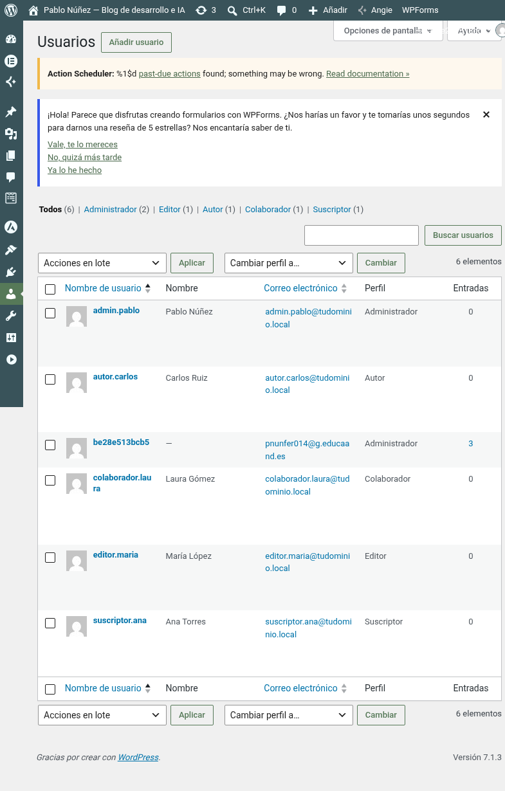

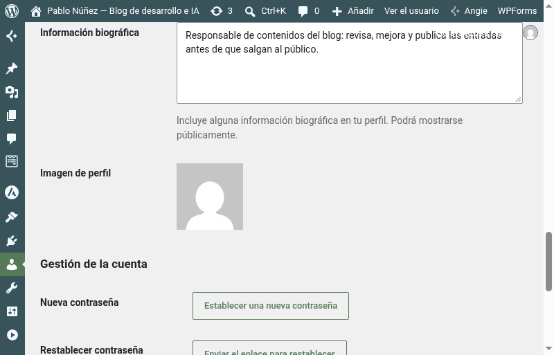

## Tarea 5. Verificación de permisos

Para poder iniciar sesión con cada uno de los 4 usuarios de prueba (las contraseñas generadas en la Tarea 4 no se habían guardado en ningún sitio), entré como administradora/TI y les reseté la contraseña desde Usuarios → [usuario] → "Establecer una nueva contraseña". A partir de aquí fui iniciando y cerrando sesión con cada rol para comprobar sus permisos reales, tal y como pide el enunciado.

1. **Colaborador (`colaborador.laura`)**: creé una entrada de prueba ("Primeros pasos con la IA generativa en desarrollo web") y comprobé que el botón disponible es "Enviar a revisión", no "Publicar": el rol Colaborador puede escribir pero no puede hacer público su propio contenido.

   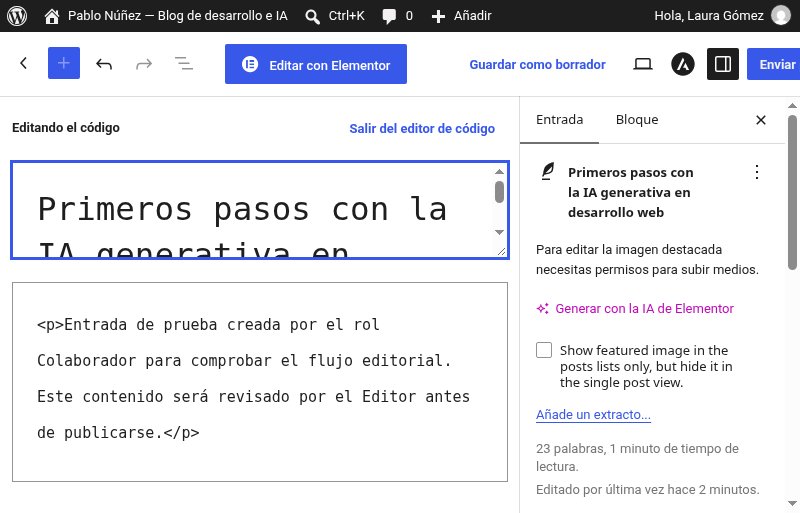

2. **Autor (`autor.carlos`)**: tenía un borrador ya preparado ("MCP: cómo conectar agentes de IA con tus herramientas favoritas"). Al pulsar "Publicar" la entrada pasó a estado publicado de forma inmediata, sin pasar por ninguna revisión: el Autor sí puede publicar sus propias entradas.

   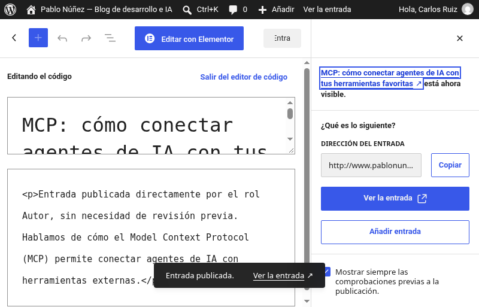

3. **Editor (`editor.maria`)**: pude abrir y editar la entrada pendiente creada por la Colaboradora (otro usuario), confirmando que el Editor puede moderar/editar contenido ajeno. Al revisar el menú lateral de administración, comprobé que **no aparecen** las opciones "Ajustes" ni "Usuarios" (solo Escritorio, Elementor, Entradas, Medios, Páginas, Comentarios, Perfil y Herramientas): el rol Editor gestiona contenido pero no tiene acceso a la configuración del sitio ni a la gestión de cuentas.

   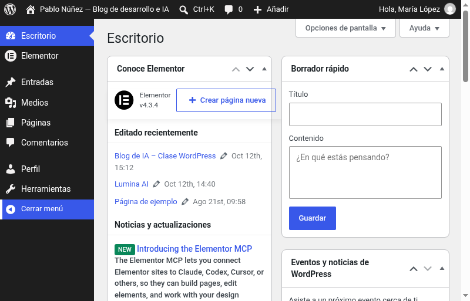

4. **Tabla resumen** comparando lo observado con la matriz de permisos de la página 12 del PDF del profesor:

   | Capacidad | Suscriptor | Colaborador | Autor | Editor | Administrador |
   |---|---|---|---|---|---|
   | Publicar sus propias entradas | No | No (solo enviar a revisión) ✓ comprobado | Sí ✓ comprobado | Sí | Sí |
   | Editar/moderar entradas de otros | No | No | No | Sí ✓ comprobado | Sí |
   | Moderar comentarios | No | No | No | Sí | Sí |
   | Administrar categorías y etiquetas | No | No | No | Sí | Sí |
   | Acceder a Usuarios | No | No | No | No ✓ comprobado | Sí |
   | Acceder a Ajustes | No | No | No | No ✓ comprobado | Sí |

   Lo observado en la práctica coincide exactamente con la matriz del profesor: el Colaborador solo puede crear/editar sus propias entradas sin publicarlas, el Autor sí publica las suyas pero no toca las de los demás, y el Editor es el primer rol con capacidad de moderar comentarios, gestionar categorías/etiquetas y editar entradas ajenas, pero sin llegar a Usuarios ni Ajustes (eso ya es exclusivo del Administrador).

## Tarea 6. Simulación de flujo de trabajo editorial

Para representar un flujo editorial limpio usé una entrada nueva, distinta a las de prueba de la Tarea 5.

1. **Colaboradora crea y envía a revisión**: con `colaborador.laura` creé la entrada "Buenas prácticas al usar agentes de IA en proyectos web" y la envié con el botón "Enviar para revisión", quedando en estado Pendiente.

   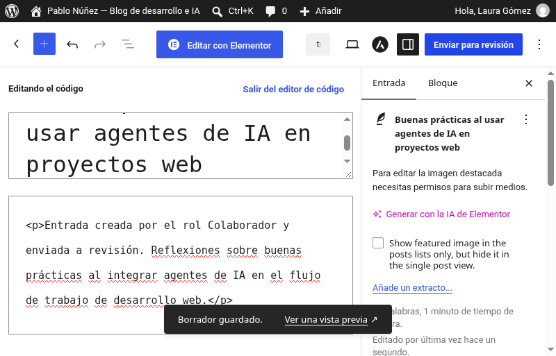

2. **Editora revisa, categoriza y publica**: con `editor.maria` abrí la entrada pendiente, confirmé la categoría "Artículos" (ya marcada por defecto), añadí la etiqueta "IA" y comprobé que los comentarios estaban "Abiertos" antes de pulsar "Publicar".

   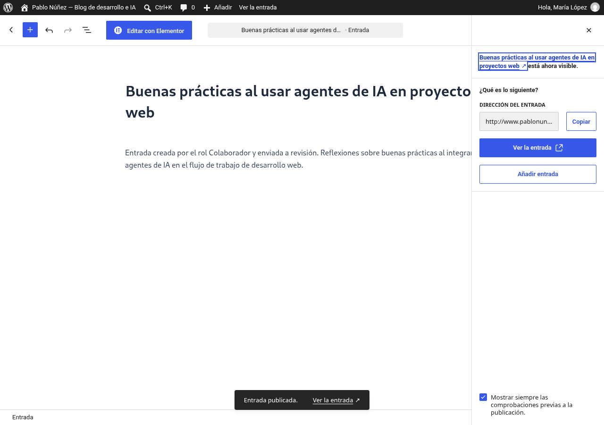

3. **Suscriptora comenta desde el sitio público**: con `suscriptor.ana`, ya identificada, entré a la página pública de la entrada (no al escritorio) y dejé un comentario preguntando por herramientas de IA; quedó marcado como "pendiente de moderación".

   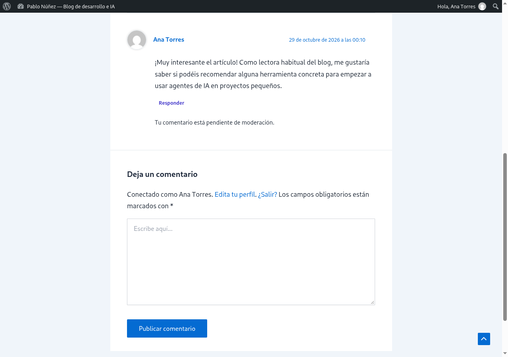

4. **Editora modera el comentario**: de vuelta como `editor.maria`, en Comentarios aprobé el comentario de Ana Torres, que pasó de "Pendiente (1)" a "Aprobados (1)".

   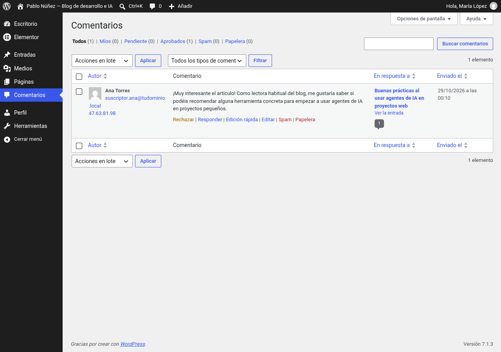

   Este recorrido completo demuestra el flujo editorial real que tenía en mente al diseñar los roles: nadie publica sin pasar un filtro salvo el Autor y el Editor/Administrador, y los comentarios de los lectores tampoco aparecen en el sitio hasta que alguien con permisos los revisa.

## Conclusiones

Esta práctica me ha hecho entender la gestión de usuarios de WordPress de forma mucho más práctica que leéndola: no es lo mismo saber que un Colaborador "no puede publicar" que verlo en pantalla con cuatro sesiones distintas abiertas y cerradas. Lo que más me costó fue precisamente el cambio constante de usuario (cerrar sesión, volver a entrar, recordar qué contraseña era de cada uno) y encontrar los campos de Categorías/Etiquetas/Comentarios en el panel lateral del editor de bloques, que estaban colapsados y había que desplegar y hacer scroll para verlos. También tuve que resetear las contraseñas de los usuarios de prueba porque no las había guardado al crearlos en la Tarea 4, lo cual me sirvió de lección para anotar ese tipo de credenciales desde el primer momento en próximas prácticas.

## Notas internas (no entregar)

Contraseñas reseteadas el 28/10/2026 para poder hacer login con cada rol durante las Tareas 5 y 6 (no se incluyen en el ZIP de entrega):

- `autor.carlos` → `Tarea5Pract!2026`
- `editor.maria` → `Tarea5Pract!2026`
- `colaborador.laura` → `Tarea5Pract!2026`
- `suscriptor.ana` → `Tarea5Pract!2026`

(`admin.pablo` no se tocó; el acceso de administración sigue siendo el usuario `be28e513bcb5`.)
